# From Packets to Pixels

> Understanding the Web. Building for the Web.

**Infinity Maths Club · Web Development Workshop · Session 01**

# Chapter 01 — The Internet

**Guiding question:** How can two computers anywhere in the world exchange information?

## Roadmap

| Phase | Question | Concept |
|---|---|---|
| [01](#01--connecting-two-computers) | How do we send information? | Binary and signals |
| [02](#02--building-a-local-network) | How do many devices communicate? | LAN and switches |
| [03](#03--connecting-networks) | How do distant networks communicate? | Routers and ISPs |
| [04](#04--establishing-communication-rules) | How do devices understand each other? | Protocols |
| [05](#05--identifying-destinations) | Where should data go? | IP and routing |
| [06](#06--transmitting-data) | How do we share network links? | Packets |
| [07](#07--ensuring-reliable-delivery) | What if data gets lost? | TCP and UDP |
| [08](#08--identifying-applications) | Which application receives data? | Ports and sockets |
| [09](#09--finding-computers-by-name) | Must we memorize addresses? | DNS |
| [10](#10--the-complete-picture) | How does everything fit together? | End-to-end communication |

## 01 — Connecting two computers

**Problem:** Alice wants to send a message to Bob. How can machines exchange information?

Computers represent information as bits. Text, images, audio and programs all have binary representations. A network interface converts data into signals suitable for a communication medium; the receiving interface interprets those signals.

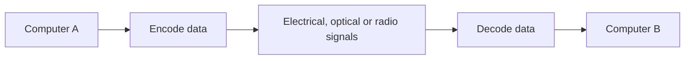

| Medium | Signal | Example |
|---|---|---|
| Copper | Electrical | Ethernet cable |
| Fiber optic | Light | Submarine fiber cable |
| Wireless | Radio | Wi-Fi |

**Example:** ASCII encoding of `Hi`:

| Character | Decimal | Binary |
|---|---:|---|
| H | 72 | 01001000 |
| i | 105 | 01101001 |

```python
print(' '.join(f'{b:08b}' for b in b'Hi'))
```

**Analogy:** Two people using a telephone need a medium that carries their voices. Computers need a medium carrying encoded signals.

**Ask:** Does Wi-Fi itself mean Internet access? No: a local wireless network can exist without Internet access.

**Transition:** Connecting two computers is easy. What if we have a hundred?

## 02 — Building a local network

A **network** is a collection of connected devices capable of exchanging data. A **LAN** (Local Area Network) connects devices within a limited area, such as a classroom.

A switch forwards Ethernet frames using learned MAC addresses. A MAC address identifies a link-layer interface; it is not an Internet-wide routing address. A wireless access point connects wireless devices to a network.

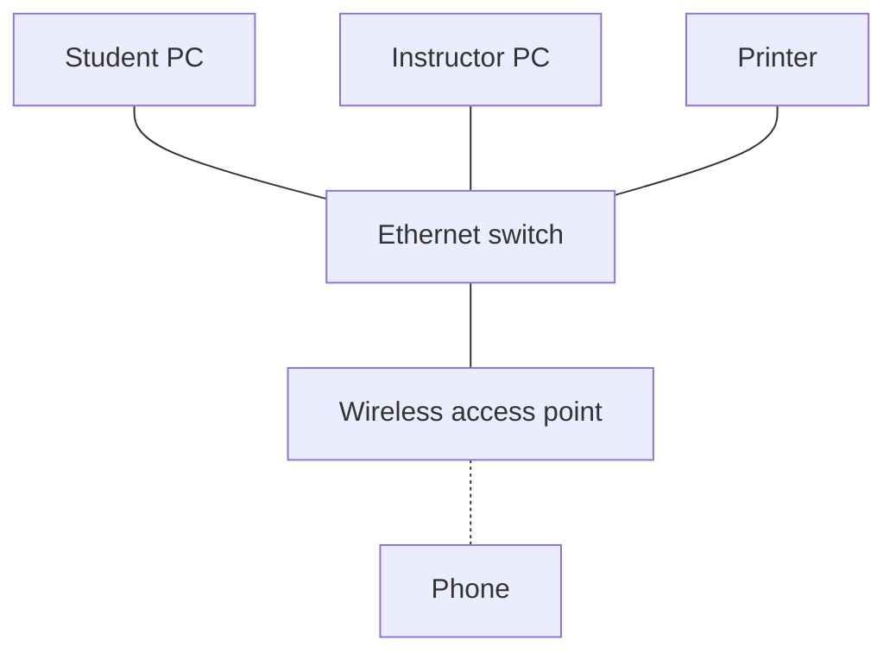

**Example:** A classroom computer sends a document to a network printer without needing the public Internet.

**Analogy:** A switch is like an internal mail desk delivering messages to the appropriate office.

**Demo:** Inspect a local network interface with `ipconfig /all` on Windows, `ip link` on Linux, or `ifconfig` on macOS. Do not share students' actual network identifiers publicly.

**Ask:** Can a LAN function without an ISP? Yes.

**Transition:** A switch connects local devices. How do we connect separate networks?

## 03 — Connecting networks

A **router** forwards IP packets between networks. Routers have processing hardware, memory, network interfaces and software. An **ISP** (Internet Service Provider) provides connectivity to other networks. A WAN spans a larger geographical area than a LAN.

The **Internet** is a global network of interconnected networks, not one central server. Its infrastructure includes terrestrial and submarine fiber, routers, data centers and wireless links.

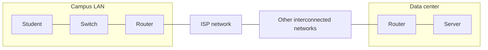

| Internet | World Wide Web |
|---|---|
| Communication infrastructure | Linked resources accessed through web technologies |
| Supports many applications | One system built on that infrastructure |
| IP and other network protocols | HTTP and HTTPS |

Email, SSH and online games can use the Internet without being web pages.

**Analogy:** Roads connect neighborhoods and cities; routers are junctions that direct traffic between networks.

**Visual reference:** [Submarine Cable Map](https://www.submarinecablemap.com/) — explore the physical links connecting continents.

**Demo:** `tracert example.com` (Windows) or `traceroute example.com` (Linux/macOS, if installed). Some hops may not respond; the displayed path is not necessarily permanent.

**Transition:** Connected devices still need agreed rules for interpreting messages.

## 04 — Establishing communication rules

A **protocol** defines the format, meaning and handling of messages exchanged between communicating devices.

**Analogy:** A conversation works because both people agree on a language and conventions for taking turns.

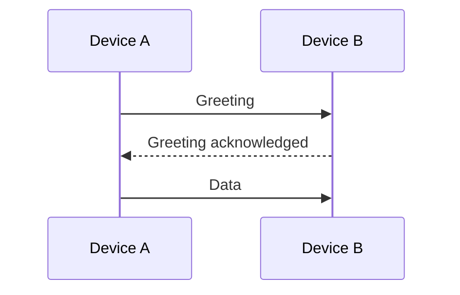

This is a conceptual conversation, not a specific network protocol.

| Protocol | Responsibility |
|---|---|
| IP | Addressing and forwarding |
| TCP | Reliable ordered byte stream |
| UDP | Datagram transport |
| DNS | Name resolution |
| HTTP | Exchange of web resources |
| TLS | Secure communication |

### TCP/IP layered model

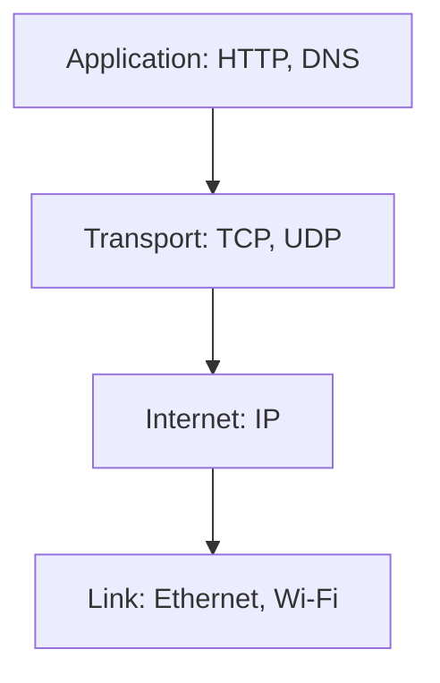

Each layer provides services to the layer above it. TCP/IP is a suite of protocols, not a single protocol.

**Ask:** Why separate addressing from reliable delivery? Different applications need different transport behavior, while sharing the same network infrastructure.

**Transition:** How does a router identify the destination?

## 05 — Identifying destinations

**IP (Internet Protocol)** defines logical addressing and packet forwarding. An IP address identifies an interface in an IP network; it is not necessarily a permanent unique identifier for a person or computer.

| | IPv4 | IPv6 |
|---|---|---|
| Size | 32 bits | 128 bits |
| Example | `192.0.2.10` | `2001:db8::10` |
| Address space | 2^32 | 2^128 |

IPv4 example: `192.168.1.10` consists of four 8-bit octets. Private IPv4 addresses can be reused in different local networks. Public addresses are intended for global routing. `127.0.0.1` is an IPv4 loopback address; `::1` is IPv6 loopback.

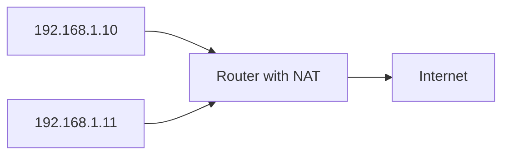

NAT can allow several private IPv4 devices to share a public IPv4 address.

### Routing

Routers consult forwarding information to select a next hop based on the destination IP address, generally using the longest matching network prefix.

| Destination | Next hop |
|---|---|
| 192.168.1.0/24 | Directly connected |
| 10.0.0.0/8 | 172.16.0.2 |
| 0.0.0.0/0 | 172.16.0.1 |

The last entry is the default route. Routing protocols such as OSPF and BGP help networks exchange reachability information; their algorithms are outside today's scope.

**Analogy:** A postal address tells each sorting office where to forward a letter next.

**Demo:** `ipconfig` (Windows), `ip addr` (Linux), `ifconfig` (macOS). Inspect routes with `route print`, `ip route`, or `netstat -rn`, respectively.

**Transition:** What if we need to send a large image instead of a short message?

## 06 — Transmitting data

A packet is a unit of network-layer data containing a header and payload. Large application data is commonly divided into smaller transport units before transmission. This allows traffic from different users to share links rather than one transfer monopolizing a link for its entire duration.

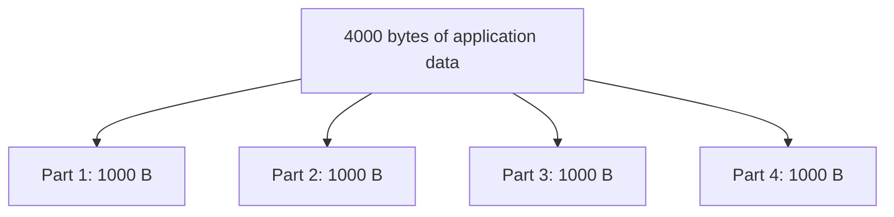

Illustrative sizes only; actual segmentation depends on the transport and network constraints.

### Encapsulation

```text
Application data:                  [ DATA ]
TCP segment:                 [ TCP | DATA ]
IP packet:              [ IP | TCP | DATA ]
Ethernet frame: [ ETH | IP | TCP | DATA | FCS ]
```

The IP header contains source and destination IP addresses. The TCP header contains transport information such as ports and sequence numbers. The receiver processes the headers in reverse order (decapsulation).

### Packet switching

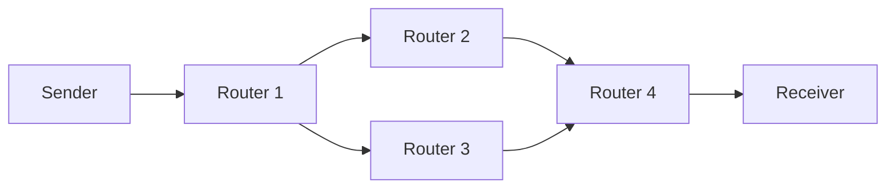

Packets may take different paths, and return traffic may follow a different route. Packets can be delayed, lost or reordered. IP provides best-effort delivery.

**Classroom demo:** Give four numbered paper slips to students acting as routers. Deliver them out of order, then ask the receiver to reconstruct the message. These numbers are conceptual, not literal TCP packet numbering.

**Transition:** What happens when one slip never arrives?

## 07 — Ensuring reliable delivery

**TCP (Transmission Control Protocol)** provides a connection-oriented, reliable, ordered byte stream. It uses sequence numbers, acknowledgments and retransmissions to recover missing data. It does not promise that a broken connection can always be recovered.

### Three-way handshake

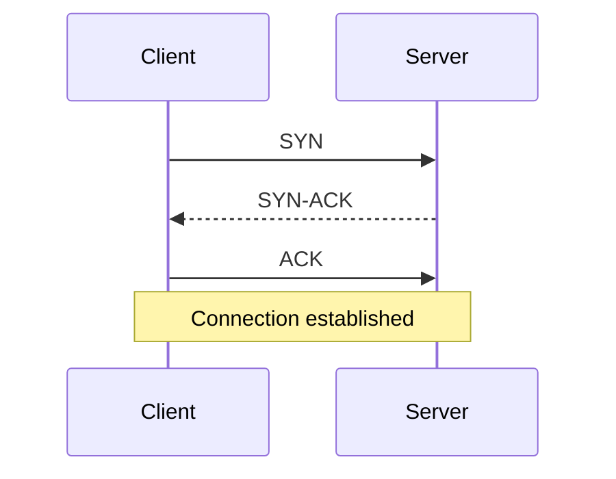

### Ordering and retransmission

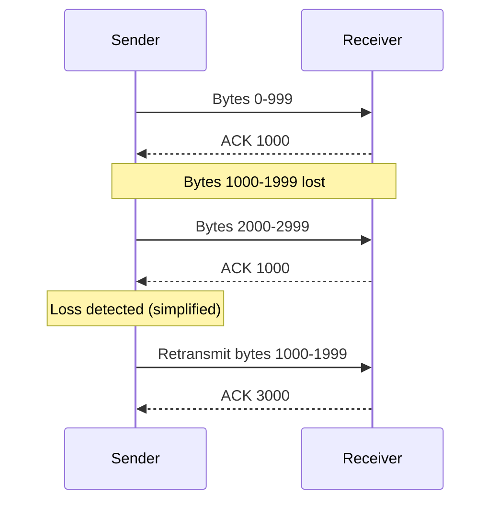

Sequence numbers count bytes, not packets. This example uses relative byte offsets and simplified cumulative acknowledgments; the receiver is assumed to buffer out-of-order data. TCP may detect loss using timers or acknowledgment-based mechanisms.

Flow control protects the receiver from being overwhelmed; congestion control adjusts sending behavior to network conditions.

| TCP | UDP |
|---|---|
| Connection-oriented | Connectionless datagrams |
| Built-in reliable ordered byte stream | No built-in delivery or ordering guarantee |
| SSH, HTTP/1.1, HTTP/2 | Many DNS queries, real-time media, QUIC |

HTTP/3 uses QUIC over UDP; QUIC implements its own reliability mechanisms.

**Analogy:** A tracked delivery service confirms receipt and resends missing items.

**Ask:** Why might a live call prefer timely data to retransmitting old audio? Late audio may no longer be useful.

**Transition:** Reliable data reaches a computer, but which application receives it?

## 08 — Identifying applications

A **port** is a 16-bit transport-layer number used to distinguish communication endpoints. TCP and UDP have separate port namespaces. Port numbers range from 0 to 65535; port 0 is reserved for special purposes.

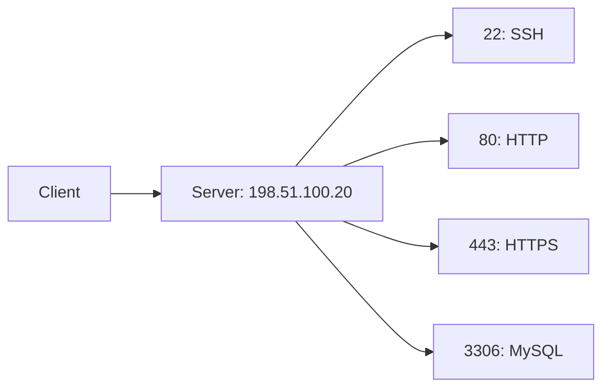

These are conventional service ports, not mandatory assignments for every deployment.

| Port | Common service |
|---:|---|
| 22 | SSH |
| 25 | SMTP |
| 53 | DNS |
| 80 | HTTP |
| 443 | HTTPS |
| 8080 | Alternative HTTP |

A client typically uses a temporary source port. A TCP connection is identified by its local and remote IP addresses and ports. A socket is an operating-system communication endpoint, not merely a port number.

**Analogy:** The IP address identifies a building; the port identifies a particular service inside it.

### Live demo: your first local server

In an empty demonstration directory, create `index.html` containing `Hello, Web!`, then run:

```bash
python -m http.server 8080 --bind 127.0.0.1
```

Use `python3` if needed. Visit `http://127.0.0.1:8080` in your browser. The browser is the client and Python is the server. Stop it with Ctrl+C. Binding to loopback keeps the demo local.

**Transition:** Do users need to memorize the IP addresses of all websites?

## 09 — Finding computers by name

**DNS (Domain Name System)** is a distributed hierarchical naming system that resolves domain names to resource records, including IP addresses.

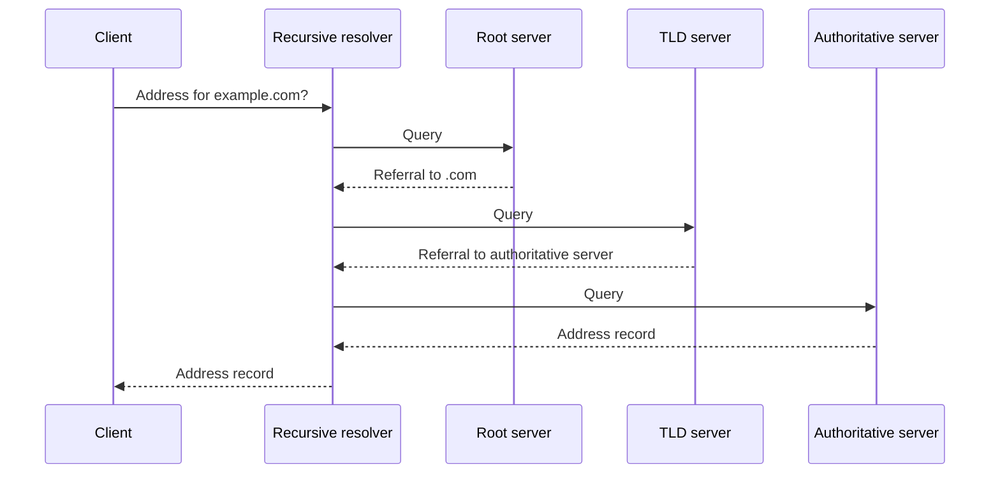

This is a simplified uncached lookup. Cached records can eliminate steps. Resolvers can be provided by ISPs, universities or public DNS providers. DNS records have a TTL that controls caching duration.

| Record | Purpose |
|---|---|
| A | IPv4 address |
| AAAA | IPv6 address |
| CNAME | Alias |
| MX | Mail exchange |
| NS | Name server |

**Analogy:** A directory helps you find a contact by name rather than memorizing their number.

**Demo:**

```bash
nslookup example.com
```

On systems with `dig`:

```bash
dig example.com A
dig example.com AAAA
```

Actual results may vary. DNS can return multiple addresses, and an address may change.

**Ask:** Is DNS the same as a search engine? No: DNS resolves names to records; search engines index and discover content.

## 10 — The complete picture

### Net neutrality

Net neutrality is the principle that ISPs should not unfairly discriminate among traffic based on its source, destination, content or application. For example, an ISP deliberately slowing a competing video service raises net-neutrality concerns. Reasonable network management is not necessarily discrimination; packets need not all experience identical latency.

### What happens when you visit a website?

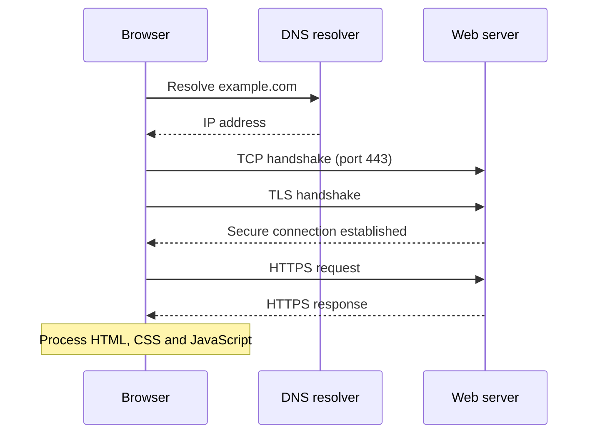

The example assumes a new HTTPS connection using HTTP/1.1 or HTTP/2, without cached DNS or connection reuse. HTTP/3 differs. All network exchanges travel through the underlying network infrastructure, including routers as needed.

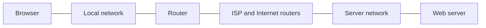

Applications can rely on the operating system and network protocols to handle communication instead of implementing signal transmission and routing themselves. This abstraction lets web developers concentrate on application behavior.

### Knowledge check

| Question | Answer (reveal after discussion) |
|---|---|
| What is the difference between Internet and Web? | Infrastructure versus a system of web resources. |
| What connects different IP networks? | Routers. |
| What identifies a network destination? | An IP address. |
| Why divide data into smaller units? | Efficient sharing of links and manageable transmission. |
| What recovers missing TCP data? | Retransmission mechanisms. |
| What distinguishes services on a host? | Transport protocol and ports. |
| What resolves domain names? | DNS. |

### Suggested presentation timing

| Phase | Minutes |
|---|---:|
| 01–02: Signals and LAN | 5 |
| 03–04: Internet architecture and protocols | 6 |
| 05: IP and routing | 5 |
| 06: Packets | 5 |
| 07: TCP | 6 |
| 08: Ports | 4 |
| 09: DNS | 4 |
| 10: Complete picture | 5 |
| **Total** | **40** |

For a beginner audience, treat MAC learning, NAT, routing protocols, TCP control mechanisms and DNS record types as optional depth. Run only the demonstrations that fit the available time.

---

## Next chapter — The Web

We now know how applications exchange data across networks. But what does a browser actually ask a web server for, and how does the server respond? Next: URLs, HTTP, requests, responses and web architecture.

## References and scope

- [Harvard CS50x 2021 — Lecture 8: The Internet](https://cs50.harvard.edu/x/2021/notes/8/#the-internet) — foundational source, based on the supplied extract.
- The problem-driven ordering, diagrams, demonstrations and additional concepts (LAN, MAC, NAT, IPv6, encapsulation, UDP, DNS hierarchy and TLS) are workshop extensions, not a verbatim reproduction of CS50.
- Documentation-range IP addresses and simplified diagrams are illustrative. Mermaid diagrams render on GitHub; terminal commands require the relevant local tools.
