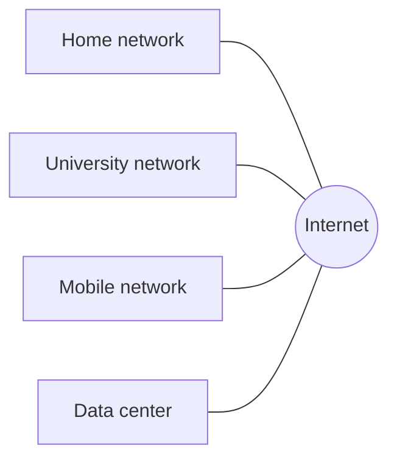
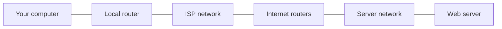
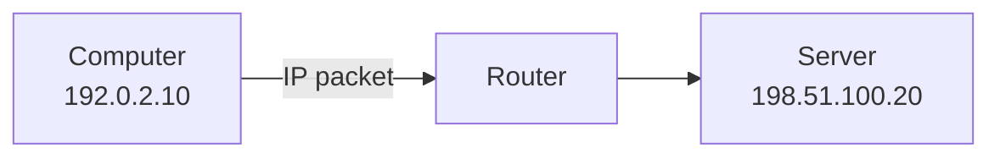
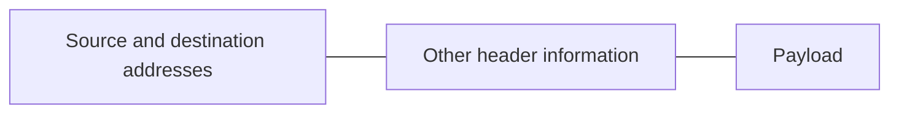
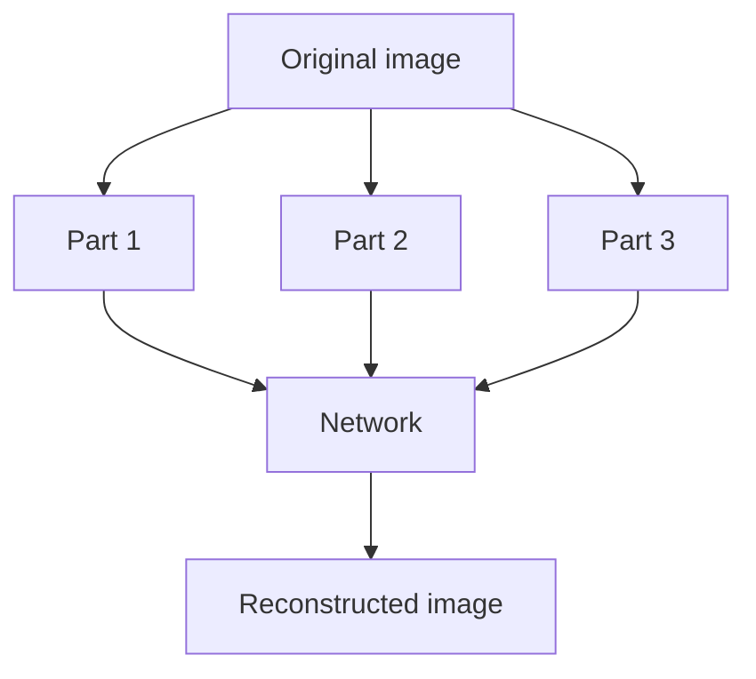
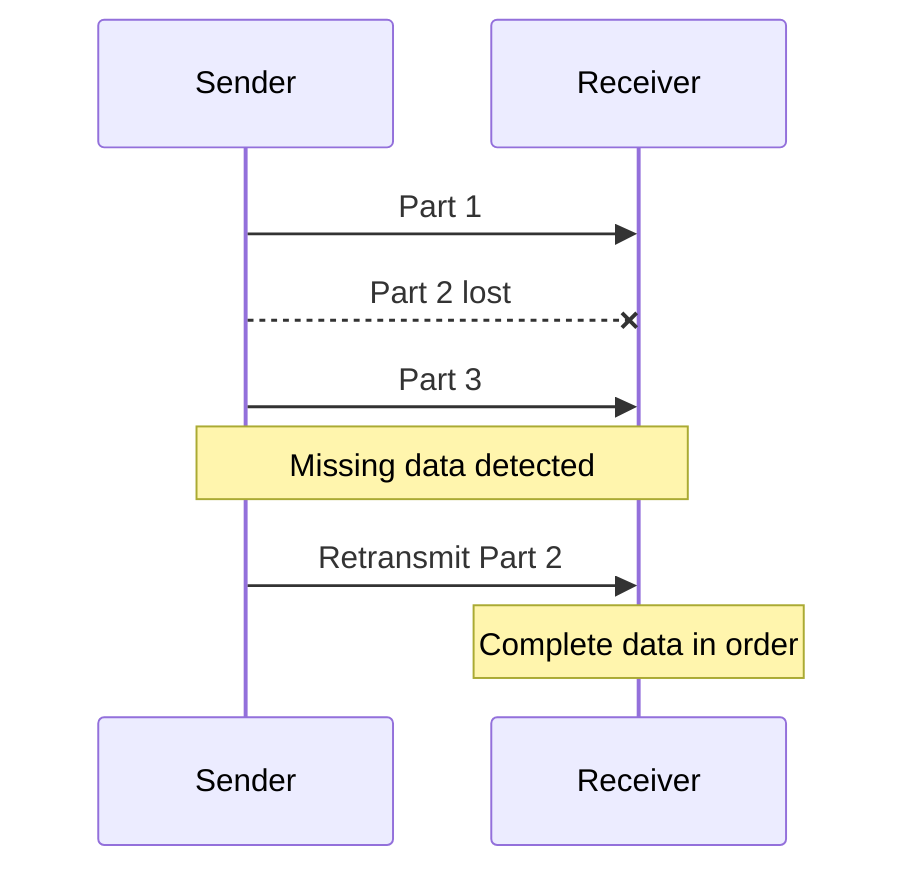
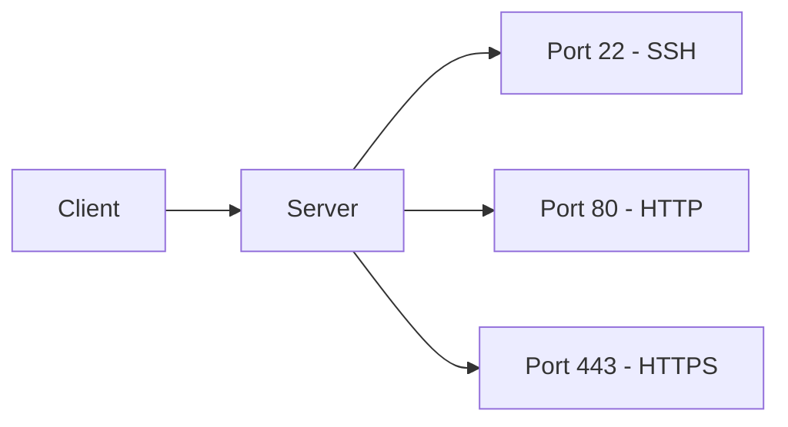
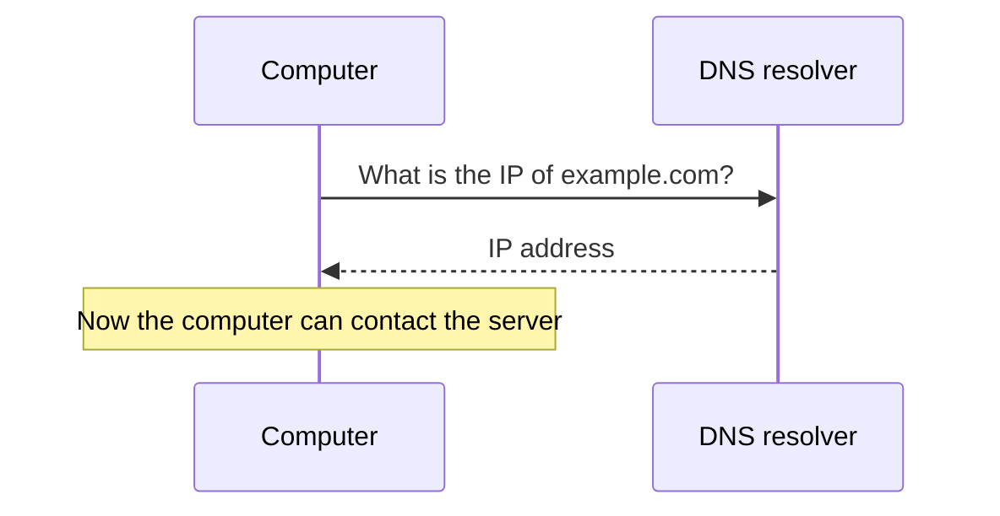
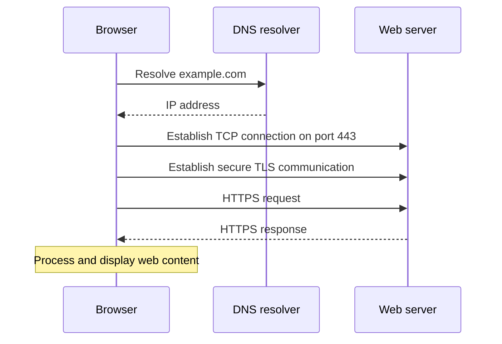

# Chapter 01 — The Internet

> **From Packets to Pixels** · Infinity Maths Club · Web Development Workshop
>
> Beginner level · 25 minutes

## Learning objective

Understand how computers communicate over the Internet before learning how websites work.

**Opening question:** What happens when you type a website address into your browser and press Enter?

## Contents

1. [What is the Internet?](#01--what-is-the-internet)
2. [Routers and Networks](#02--routers-and-networks)
3. [Protocols and IP Addresses](#03--protocols-and-ip-addresses)
4. [Packets and TCP](#04--packets-and-tcp)
5. [Ports](#05--ports)
6. [DNS](#06--dns)
7. [Putting Everything Together](#putting-everything-together)

---

## 01 — What is the Internet?

**Question:** How can computers anywhere in the world communicate?

The Internet is a global network of interconnected computer networks. It provides the infrastructure that allows devices to exchange data.



Everything computers exchange is represented as binary data: text, images, audio and video. These bits are transmitted using electrical signals, light or radio waves.

**Example:** The character `H` is represented as `01001000` in ASCII.

### Internet vs. Web

| Internet | World Wide Web |
| --- | --- |
| Infrastructure connecting networks | System of linked pages and resources |
| Carries data between devices | Uses the Internet to deliver web content |
| Supports email, games and the Web | Uses protocols such as HTTP and HTTPS |

**Analogy:** The Internet is the road network; the Web is one of the services that uses those roads.

**Next question:** How does data travel between different networks?

---

## 02 — Routers and Networks

A **router** is a networking device that forwards data between networks. An **Internet Service Provider (ISP)** connects customers to the wider Internet.



Routers examine destination addresses and use routing tables to decide where to forward packets next. Routing protocols help routers learn available paths. There can be multiple paths through the Internet.

**Analogy:** Routers are like postal distribution centers that forward letters toward their destinations.

**Example:** A student in Morocco accesses a website hosted in another country. The data may travel through several interconnected networks and routers.

### Live demonstration (optional)

```bash
# Linux / macOS
traceroute example.com

# Windows
tracert example.com
```

This shows responding network hops along a path. Some routers may not respond.

**Next question:** How do routers know the destination, and how do computers agree on how to communicate?

---

## 03 — Protocols and IP Addresses

A **protocol** is a set of agreed rules for communication between devices.

**IP (Internet Protocol)** provides addressing and packet forwarding across networks. An IP address identifies a network interface, allowing data to be directed toward its destination.



| Version | Example | Address size |
| --- | --- | --- |
| IPv4 | `192.0.2.10` | 32 bits |
| IPv6 | `2001:db8::10` | 128 bits |

These are illustrative addresses reserved for documentation.

**Analogy:** An IP address is like a postal address. A protocol defines the rules for preparing and delivering the letter.

**Example:** A packet can contain a source IP address and a destination IP address. Routers use the destination to forward it.

### Live demonstration (optional)

```bash
# Windows
ipconfig

# Linux
ip addr

# macOS
ifconfig
```

Show the class an IP address assigned to a local network interface.

**Next question:** How do we send large amounts of data without occupying an entire network link?

---

## 04 — Packets and TCP

A **packet** is a unit of data transmitted over a network. It contains control information (a header) and the data it carries (a payload).



Large amounts of data are divided into smaller pieces. This allows different users to share network links and makes it possible to recover missing data without resending an entire file.



### TCP — Transmission Control Protocol

TCP provides reliable, ordered delivery of a stream of bytes. It uses sequence numbers, acknowledgments and retransmissions to recover missing data.



Part numbers are simplified teaching labels; actual TCP sequence numbers track byte positions.

**Analogy:** Imagine sending a book in several numbered envelopes. If one is missing, the sender can send that part again.

**Example:** When downloading an image over TCP, missing data can be retransmitted so the application receives the correct byte stream. If recovery fails, the connection can fail.

**TCP/IP in one sentence:** IP helps data reach the destination; TCP helps applications receive data reliably and in order.

**Net neutrality:** The principle that ISPs should not unfairly discriminate between Internet traffic, for example by deliberately slowing a competing service. It does not mean every packet must experience identical latency.

**Next question:** What if one computer runs several different network services?

---

## 05 — Ports

A **port** is a number used by transport protocols such as TCP and UDP to distinguish communication endpoints on a device.

One server can offer multiple services using different ports.



| Port | Common service |
| --- | --- |
| 22 | SSH |
| 53 | DNS |
| 80 | HTTP |
| 443 | HTTPS |
| 8080 | Alternative HTTP port |

These are conventional port assignments; services can use other ports.

**Analogy:** An IP address identifies a building; a port identifies a particular door.

### Live demonstration

In an empty demonstration directory, start a local web server (requires Python 3):

```bash
python -m http.server 8080 --bind 127.0.0.1
```

Use `python3` instead of `python` if needed. Open `http://127.0.0.1:8080` in your browser.

- `127.0.0.1` refers to your own computer (localhost).
- `8080` identifies the server's listening port.
- Stop the server with `Ctrl+C`.

**Next question:** Do we need to memorize IP addresses for every website?

---

## 06 — DNS

**DNS (Domain Name System)** is a distributed naming system that can translate human-readable domain names into IP addresses.

A DNS resolver may be provided by an ISP, a university or another DNS provider.



**Analogy:** DNS is like a phone book: look up a name to find its number.

**Example:** Instead of memorizing a server's IP address, users can type `example.com`. The underlying address may change while the domain name stays the same.

### Live demonstration

```bash
nslookup example.com
```

Observe the returned IP address or addresses. Results may vary.

---

## Putting Everything Together

Return to our opening question: **What happens when you visit `https://example.com`?**



In this simplified example of a new HTTPS connection using HTTP/1.1 or HTTP/2:

1. DNS resolves the domain name into an IP address.
2. The browser connects to the server on port 443 using TCP.
3. TLS establishes secure communication.
4. The browser sends a request; the server returns a response.
5. Throughout the exchange, routers forward packets and TCP handles reliable, ordered delivery.
6. The browser processes the received web resources.

Cached DNS results, reused connections and HTTP/3 can change this sequence. We will explore HTTP and HTTPS in Chapter 02.

### Quick recap

| Concept | Responsibility |
| --- | --- |
| Internet | Connects networks |
| Router | Forwards packets |
| Protocol | Defines communication rules |
| IP | Provides addressing and forwarding |
| Packet | Carries data and control information |
| TCP | Provides reliable, ordered delivery |
| Port | Distinguishes communication endpoints |
| DNS | Resolves names into addresses |

### Check your understanding

- Is the Internet the same as the Web?
- What does a router do?
- Why is data divided into smaller pieces?
- What happens if TCP data is lost?
- What is the difference between an IP address and a port?
- Why do we need DNS?

## Suggested timing

| Section | Minutes |
| --- | ---: |
| Internet | 3 |
| Routers and networks | 4 |
| Protocols and IP | 4 |
| Packets and TCP | 5 |
| Ports | 3 |
| DNS | 3 |
| Recap | 3 |
| **Total** | **25** |

> **Next chapter — Web Development:** Now that we know how computers exchange data, how do browsers and servers use that infrastructure to deliver websites?

## Reference

- [Harvard CS50x 2021 — Week 8: The Internet](https://cs50.harvard.edu/x/2021/notes/8/#the-internet) — conceptual inspiration, adapted for a beginner workshop.
