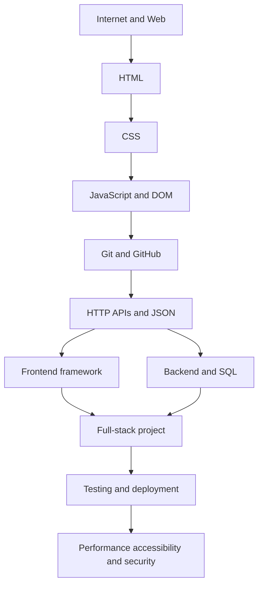

# From Packets to Pixels — Web Development Learning Hub

> Understand the Web. Build for the Web. Keep learning.

A curated learning path for students continuing after the introductory workshop. Start with HTML, CSS and JavaScript, then move toward building, testing and deploying complete web applications.

## Table of contents

- [Learning roadmap](#learning-roadmap)
- [Complete courses](#complete-courses)
- [Learning resources by topic](#learning-resources-by-topic)
- [Practice platforms](#practice-platforms)
- [Developer toolkit](#developer-toolkit)
- [Videos and books](#videos-and-books)
- [Project roadmap](#project-roadmap)
- [Study plan](#study-plan)
- [How to learn effectively](#how-to-learn-effectively)

## Learning roadmap

- [ ] Build a simple HTML page from scratch.
- [ ] Style it and make it work on a phone.
- [ ] Add interactive buttons and forms with JavaScript.
- [ ] Save project history with Git and publish a static site.
- [ ] Fetch data from an API and handle errors.
- [ ] Build a frontend using one framework.
- [ ] Create a backend and connect a database.
- [ ] Test and deploy a complete application.

For more detailed maps: [Frontend](https://roadmap.sh/frontend), [Backend](https://roadmap.sh/backend), [Full stack](https://roadmap.sh/full-stack), [JavaScript](https://roadmap.sh/javascript). These are reference maps, not lists you must finish before building anything.

## Complete courses

Choose **one main course** and use the others as references. Most resources below are free to learn from; some platforms charge for optional features, certificates or premium content.

| Resource | Level | Why use it? |
|---|---|---|
| [MDN Learn Web Development](https://developer.mozilla.org/en-US/docs/Learn_web_development) | Beginner | Structured web fundamentals and exercises |
| [freeCodeCamp](https://www.freecodecamp.org/learn/) | Beginner onward | Interactive lessons and projects |
| [The Odin Project](https://www.theodinproject.com/) | Beginner onward | Project-driven full-stack curriculum |
| [Microsoft Web Dev for Beginners](https://github.com/microsoft/Web-Dev-For-Beginners) | Beginner | Guided lessons and practical projects |
| [W3Schools](https://www.w3schools.com/) | Beginner | Quick examples and browser-based practice |
| [CS50x](https://cs50.harvard.edu/x/) | Beginner onward | Computer science foundations |
| [CS50 Web](https://cs50.harvard.edu/web/) | Intermediate | Python, JavaScript and web applications |
| [Full Stack Open](https://fullstackopen.com/en/) | Intermediate onward | Modern full-stack development; learn programming basics first |
| [web.dev Learn](https://web.dev/learn/) | Beginner onward | Modern web platform and quality practices |
| [Scrimba](https://scrimba.com/) | Beginner onward | Interactive video lessons; free and paid options |

**Start here:** MDN Getting Started or Odin Foundations. If you prefer interactive exercises, try freeCodeCamp.

## Learning resources by topic

### 01 — Internet and Web fundamentals

Learn IP, DNS, HTTP, HTTPS, URLs, clients, servers, requests and responses.

- [MDN — How the Web works](https://developer.mozilla.org/en-US/docs/Learn_web_development/Getting_started/Web_standards/How_the_web_works)
- [MDN — HTTP](https://developer.mozilla.org/en-US/docs/Web/HTTP)
- [HTTP Cats](https://http.cat/) — memorable HTTP status codes.
- [Cloudflare Learning Center](https://www.cloudflare.com/learning/) — explanations of networking and web infrastructure.

**Practice:** Open browser DevTools, visit a public webpage and inspect its Network tab. Identify the request URL, method and status code.

### 02 — HTML

Learn tags, attributes, headings, links, images, lists, semantic elements, forms and accessible labels.

- [MDN HTML](https://developer.mozilla.org/en-US/docs/Web/HTML) — reference.
- [W3Schools HTML](https://www.w3schools.com/html/) — simple examples.
- [HTML Living Standard](https://html.spec.whatwg.org/) — advanced specification, not a first tutorial.
- [W3C HTML validator](https://validator.w3.org/) — check markup.

**Build:** A personal profile page, followed by a simple club website.

### 03 — CSS

Learn selectors, colors, fonts, spacing, box model, cascade, Flexbox, Grid, responsive layouts and transitions.

- [MDN CSS](https://developer.mozilla.org/en-US/docs/Web/CSS)
- [Learn CSS](https://web.dev/learn/css/)
- [CSS-Tricks](https://css-tricks.com/) — visual layout guides and articles.
- [Flexbox Froggy](https://flexboxfroggy.com/) — interactive Flexbox game.
- [Grid Garden](https://cssgridgarden.com/) — interactive Grid game.
- [CSSBattle](https://cssbattle.dev/) — visual CSS challenges.

**Build:** Style your HTML page, then recreate a simple landing page that works on small and large screens.

### 04 — JavaScript

Learn variables, types, conditions, loops, arrays, objects, functions, DOM, events, modules, promises, async/await and fetch.

- [JavaScript.info](https://javascript.info/) — progressive JavaScript tutorial.
- [MDN JavaScript](https://developer.mozilla.org/en-US/docs/Web/JavaScript) — guides and reference.
- [JavaScript30](https://javascript30.com/) — vanilla JS projects after the basics.
- [Exercism JavaScript](https://exercism.org/tracks/javascript) — coding exercises.
- [Eloquent JavaScript](https://eloquentjavascript.net/) — free online book.

**Build:** A counter, quiz, calculator and to-do list. Learn to use the console to debug each one.

### 05 — Git, GitHub and command line

Learn repositories, commits, branches, merging, pull requests and basic shell navigation.

- [Git book](https://git-scm.com/book/en/v2) — free reference.
- [GitHub Skills](https://skills.github.com/) — hands-on exercises.
- [Learn Git Branching](https://learngitbranching.js.org/) — interactive visualization.
- [GitHub Documentation](https://docs.github.com/)
- [The Missing Semester](https://missing.csail.mit.edu/) — shell and developer tooling.

**Build habit:** Commit after each meaningful improvement to your project.

### 06 — APIs and asynchronous JavaScript

Learn JSON, REST conventions, GET/POST, status codes, fetch, promises, loading and error states.

- [MDN Web APIs](https://developer.mozilla.org/en-US/docs/Web/API)
- [MDN Fetch API](https://developer.mozilla.org/en-US/docs/Web/API/Fetch_API)
- [JSONPlaceholder](https://jsonplaceholder.typicode.com/) — sample API data for practice.
- [Open-Meteo](https://open-meteo.com/) — weather data API; check usage terms.
- [Postman Learning Center](https://learning.postman.com/) — learn API requests.

**Build:** A weather dashboard or searchable list using sample API data. Do not put private API keys in frontend code.

### 07 — Frontend frameworks and TypeScript

Only start when you can build a small interactive site with plain JavaScript. Choose one framework, not all of them.

| Resource | Purpose |
|---|---|
| [React Learn](https://react.dev/learn) | Components, state and UI |
| [Vue Guide](https://vuejs.org/guide/) | Alternative frontend framework |
| [Svelte Tutorial](https://svelte.dev/tutorial) | Alternative component framework |
| [Angular](https://angular.dev/) | Structured application framework |
| [TypeScript Handbook](https://www.typescriptlang.org/docs/handbook/intro.html) | Static typing for JavaScript |
| [Vite](https://vite.dev/) | Development server and build tooling |
| [Next.js Learn](https://nextjs.org/learn) | React-based application framework, after React |
| [Tailwind CSS](https://tailwindcss.com/docs) | Utility-based styling, after regular CSS |

**Build:** Rebuild your to-do list as components, then create a dashboard.

### 08 — Backend development

Learn routing, validation, CRUD (create, read, update, delete), server-side logic, sessions and error handling. Choose one path.

| JavaScript path | Python path |
|---|---|
| [Node.js Learn](https://nodejs.org/en/learn) | [Python Tutorial](https://docs.python.org/3/tutorial/) |
| [Express](https://expressjs.com/) | [Flask](https://flask.palletsprojects.com/) |
| [npm Docs](https://docs.npmjs.com/) | [FastAPI](https://fastapi.tiangolo.com/) |
| [Full Stack Open](https://fullstackopen.com/en/) | [Django](https://docs.djangoproject.com/) |

**Build:** A local notes API with routes for creating, reading, updating and deleting notes.

### 09 — Databases

Learn SQL, tables, keys, relationships, joins, constraints, transactions and indexes before depending on an ORM.

- [SQLBolt](https://sqlbolt.com/) — interactive SQL lessons.
- [CS50 SQL](https://cs50.harvard.edu/sql/) — database course.
- [SQLite](https://www.sqlite.org/docs.html) — simple local database.
- [PostgreSQL tutorial](https://www.postgresql.org/docs/current/tutorial.html) — relational databases.
- [MongoDB Docs](https://www.mongodb.com/docs/) — optional document database.
- [Prisma](https://www.prisma.io/docs) — optional JavaScript ORM.

**Build:** Store notes or tasks in a database instead of losing them when the server restarts.

### 10 — Testing, accessibility and quality

- [Vitest](https://vitest.dev/) — JavaScript unit testing.
- [Playwright](https://playwright.dev/) — browser end-to-end testing.
- [Testing Library](https://testing-library.com/) — UI testing.
- [W3C Accessibility Tutorials](https://www.w3.org/WAI/tutorials/) — accessible web content.
- [The A11Y Project](https://www.a11yproject.com/) — accessibility guides and checklist.
- [web.dev Performance](https://web.dev/learn/performance/) — loading and rendering performance.
- [OWASP Cheat Sheet Series](https://cheatsheetseries.owasp.org/) — defensive guidance for securing your own applications, especially authentication, input validation and secrets management.

**Practice:** Test your own project with keyboard navigation, narrow screens, invalid input and a failing API request. Never store plaintext passwords or publish secrets.

### 11 — Deployment and DevOps

Learn static hosting, environment variables, deployment logs, continuous integration and containers after you understand local development.

- [GitHub Pages](https://pages.github.com/) — publish static websites.
- [Netlify Docs](https://docs.netlify.com/) — deployment guides.
- [Vercel Docs](https://vercel.com/docs) — frontend and framework deployment.
- [Docker Get Started](https://docs.docker.com/get-started/) — containers.
- [GitHub Actions](https://docs.github.com/en/actions) — automate tests and builds.

Check provider account requirements, pricing and quotas before signing up or deploying. Never publish personal records, secrets or private data in practice projects.

## Practice platforms

| Platform | What to practice |
|---|---|
| [Frontend Mentor](https://www.frontendmentor.io/) | Turn designs into real webpages |
| [CodePen](https://codepen.io/) | Experiment with HTML, CSS and JS |
| [JSFiddle](https://jsfiddle.net/) | Small browser experiments |
| [Exercism](https://exercism.org/) | Programming exercises |
| [Codewars](https://www.codewars.com/) | JavaScript problem solving |
| [CSSBattle](https://cssbattle.dev/) | CSS precision |
| [DevChallenges](https://devchallenges.io/) | Project challenges |
| [App Ideas](https://github.com/florinpop17/app-ideas) | Project inspiration |

## Developer toolkit

| Tool | Purpose |
|---|---|
| [VS Code](https://code.visualstudio.com/) | Code editor |
| [Chrome DevTools](https://developer.chrome.com/docs/devtools/) | Inspect, debug and profile websites |
| [Firefox DevTools](https://firefox-source-docs.mozilla.org/devtools-user/) | Browser debugging |
| [Can I use](https://caniuse.com/) | Browser compatibility |
| [Google Fonts](https://fonts.google.com/) | Web typography |
| [Lucide](https://lucide.dev/) | Icons |
| [Coolors](https://coolors.co/) | Color palette ideas |
| [Figma](https://www.figma.com/) | Interface design and prototyping |
| [Prettier](https://prettier.io/) | Code formatting |
| [ESLint](https://eslint.org/) | JavaScript linting |
| [PageSpeed Insights](https://pagespeed.web.dev/) | Performance checks |
| [DevDocs](https://devdocs.io/) | Searchable documentation |
| [HTML Reference](https://htmlreference.io/) | Visual HTML reference |
| [CSS Reference](https://cssreference.io/) | Visual CSS reference |
| [GitHub Git cheat sheet](https://education.github.com/git-cheat-sheet-education.pdf) | Quick Git commands |

## Videos and books

### Video channels

- [freeCodeCamp](https://www.youtube.com/@freecodecamp) — long-form courses.
- [Kevin Powell](https://www.youtube.com/@KevinPowell) — CSS and responsive design.
- [Traversy Media](https://www.youtube.com/@TraversyMedia) — practical web projects.
- [Web Dev Simplified](https://www.youtube.com/@WebDevSimplified) — focused JS and web lessons.
- [The Net Ninja](https://www.youtube.com/@NetNinja) — topic-based tutorial series.
- [Fireship](https://www.youtube.com/@Fireship) — short technology overviews; not a substitute for practice.
- [Grafikart](https://grafikart.fr/) — French-language web tutorials.
- [Elzero Web School](https://elzero.org/) — Arabic-language web tutorials.

### Books and deeper references

- [Eloquent JavaScript](https://eloquentjavascript.net/) — programming and JavaScript.
- [You Don't Know JS Yet](https://github.com/getify/You-Dont-Know-JS) — deeper language concepts.
- [Pro Git](https://git-scm.com/book/en/v2) — version control.
- [Patterns.dev](https://www.patterns.dev/) — application design and rendering patterns, after fundamentals.
- [The Architecture of Open Source Applications](https://aosabook.org/en/) — software architecture, later reading.

## Project roadmap

| Level | Project | Skills |
|---|---|---|
| 1 | Personal webpage | HTML |
| 2 | Club landing page | CSS, responsive design |
| 3 | Interactive profile and counter | DOM, click events |
| 4 | Quiz and calculator | Functions, conditions, state |
| 5 | To-do list | Arrays, DOM, local storage |
| 6 | Weather dashboard | Fetch, JSON, error handling |
| 7 | Component-based dashboard | Framework, state, routing |
| 8 | Notes API | Backend routing, CRUD, validation |
| 9 | Full-stack task manager | API, database, frontend |
| 10 | Club event management demo | Full stack, testing, accessibility, deployment |

Use fictional data for demo projects. For the final project, include a README, setup steps, screenshots, tests and a description of design decisions. Add authentication only after learning established secure framework practices.

## Study plan

This is a suggested 12-week starting plan, not a promise of mastery. Move at your own pace.

| Weeks | Focus | Deliverable |
|---|---|---|
| 1–2 | HTML and CSS | Personal website |
| 3–4 | JavaScript fundamentals and DOM | Interactive quiz |
| 5 | Git and browser debugging | Published static site |
| 6 | HTTP, JSON, APIs | Data dashboard |
| 7–8 | One frontend framework | Component-based app |
| 9–10 | One backend framework and SQL | Persistent notes API |
| 11–12 | Integrate, test, deploy | Full-stack demo |

Continue with deeper accessibility, performance, testing, TypeScript, backend architecture and maintainability afterwards.

## How to learn effectively

1. Read or watch one short lesson.
2. Reproduce the example yourself.
3. Close the tutorial and rebuild it from memory.
4. Change something without following instructions.
5. Debug the result, consult documentation and commit your work.
6. Explain how it works to another student.

Avoid tutorial hopping. Use one curriculum, keep building projects and learn new tools when you have a reason to use them.

## Where to begin today

Finish the workshop's HTML, CSS and JavaScript project. Next, make the page your own, complete the MDN Getting Started modules, and choose a simple Frontend Mentor challenge or Odin Foundations project.

---

*From Packets to Pixels — keep building, one line at a time.*

Resource selection is curated for this workshop. MDN and The Odin Project course descriptions were checked against their official sites; other links are recommended references and were not individually live-tested. Availability, pricing and platform requirements may change.
