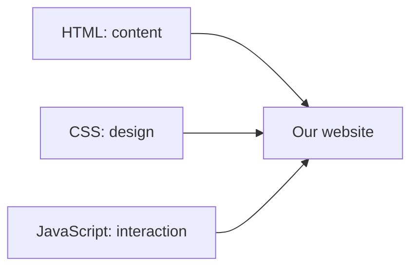

# Chapter 05 — JavaScript

> From Packets to Pixels | Absolute beginners

## 1. What is JavaScript?

JavaScript is a programming language that makes webpages interactive. It can react to a click and change text on the page.

**Fun fact:** JavaScript and Java are different languages.

## 2. Connect JavaScript to our existing page

Open the same `my-website` folder and create `script.js`.

```text
my-website/
├── index.html
├── style.css
└── script.js
```

In `index.html`, add this line just before the closing `</body>` tag:

```html
<script src="script.js"></script>
```

The browser will load the JavaScript after reading our page content.

## 3. Your first JavaScript instruction

Write this in `script.js`:

```javascript
console.log("Hello, world!");
```

Save and refresh. Open the browser Developer Tools (right-click the page, choose Inspect, then Console). You should see `Hello, world!`.

`console.log()` prints a message in the developer console, not on the webpage.

## 4. Make our button work

Replace the code in `script.js` with:

```javascript
const button = document.querySelector("button");

button.addEventListener("click", function () {
    alert("Hello! Welcome to my website.");
});
```

| Code | Meaning |
| --- | --- |
| `const button` | Gives the selected button a name in our code |
| `document.querySelector("button")` | Finds the button on the page |
| `addEventListener("click", ...)` | Waits for a click |
| `function () { ... }` | Groups instructions to run when clicked |
| `alert(...)` | Displays a message box |

Save, refresh and click the button. Close the message box to return to the page.

## 5. Change the heading instead

Replace the script with this final version:

```javascript
const button = document.querySelector("button");
const heading = document.querySelector("h1");

button.addEventListener("click", function () {
    heading.textContent = "Welcome, developer!";
});
```

`textContent` changes the text inside an HTML element. Click the button and watch the heading change without refreshing the page.

**Try it:** Change the message to anything you like. Save, refresh and click again.

If nothing happens, check that `script.js` is spelled correctly, the script tag is before `</body>`, and the browser console has no errors.

## 6. What did we build?



You built one website in three steps. HTML created the heading and button, CSS styled them, and JavaScript made the button change the heading.

**Congratulations!** You have created your first interactive webpage.
