# From Packets to Pixels
## Chapter 02 — Web Development

> Infinity Maths Club · Web Development Workshop · Session 01

**From computer-to-computer communication to browser-to-server communication.**

In Chapter 01, we learned how networks, IP, TCP, ports and DNS enable applications to exchange data. Now we need to understand what those applications actually say to each other.

**Driving question:** What happens when you enter a URL into your browser?

## Roadmap

| Phase | Question | Concept |
|---|---|---|
| 01 | What can we build on the Internet? | World Wide Web |
| 02 | Who requests and who provides resources? | Client-server architecture |
| 03 | How do we identify a resource? | URLs |
| 04 | How do browsers and servers communicate? | HTTP |
| 05 | How do we express an intention? | HTTP requests and methods |
| 06 | How does the server answer? | Responses and status codes |
| 07 | How do we protect communication? | HTTPS and TLS |
| 08 | Where does application logic run? | Frontend, backend and databases |
| 09 | How is content produced? | Static and dynamic websites |
| 10 | How does code become a page? | Browser rendering and the complete journey |

---

## Phase 01 — The World Wide Web

### The problem

The Internet lets computers exchange bytes, but does not itself define how to publish, identify or retrieve a web page.

The **World Wide Web** is a system of linked resources identified by URLs and commonly accessed using HTTP or HTTPS. A browser is an application that retrieves and presents web resources.

| Internet | Web |
|---|---|
| Network infrastructure | System of linked resources |
| IP, TCP, UDP and other protocols | HTTP, HTTPS, URLs, HTML |
| Supports many applications | One application ecosystem |

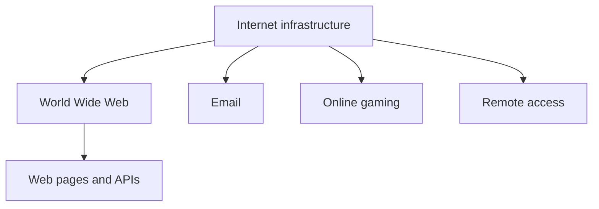

**Analogy:** The Internet is a road network; the Web is a service using those roads.

**Example:** A university website contains pages, images and links to other resources. Each resource can be identified by a URL.

**Ask:** Is sending an email necessarily the same as browsing the Web? No: email can use its own protocols, even though webmail provides a web interface.

**Next problem:** Who provides these resources?

---

## Phase 02 — Client-server architecture

A **client** initiates a request. A **server** listens for requests and provides responses. These are roles played by software, not necessarily different kinds of hardware.

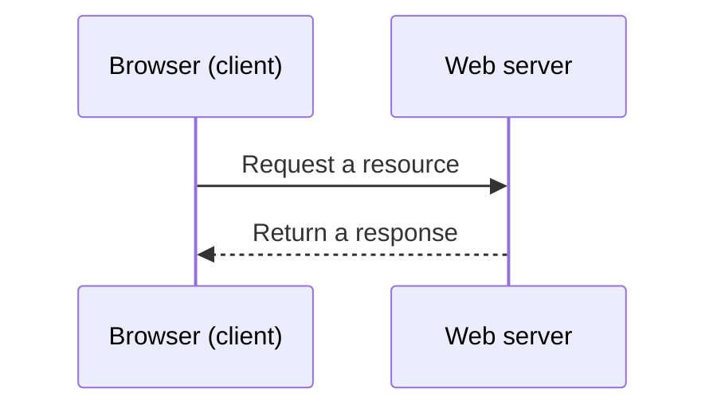

A web server may return an HTML document, image, stylesheet, script or JSON data. Many clients can communicate with one server. A single machine can also run both client and server programs.

**Analogy:** A restaurant customer orders a meal; the kitchen prepares and returns it.

### Live demonstration: your first server

Create an empty workshop directory, then create `index.html` containing:

```html
<!doctype html>
<html lang="en">
  <head><title>Workshop</title></head>
  <body><h1>Hello, Web!</h1></body>
</html>
```

From that directory run:

```bash
python3 -m http.server 8080 --bind 127.0.0.1
```

On Windows, `py -m http.server 8080 --bind 127.0.0.1` may be appropriate. Open `http://127.0.0.1:8080/` in a browser. Stop the server with Ctrl+C when finished. This is a local teaching server, not a production server.

- Browser: client.
- Python process: server.
- `127.0.0.1`: loopback address.
- `8080`: destination port.
- `index.html`: resource served by default for this directory.

**Next problem:** How does the browser identify exactly which resource it wants?

---

## Phase 03 — URLs

A **Uniform Resource Locator (URL)** identifies a resource and describes how to access it.

```text
https://example.com:443/courses/web?session=1#intro
```

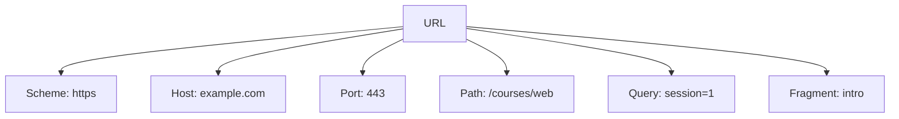

| Component | Purpose |
|---|---|
| Scheme | Access mechanism, such as HTTPS |
| Host | Domain name or IP address |
| Port | Service endpoint; defaults to 80 for HTTP and 443 for HTTPS |
| Path | Identifies a resource within the server's URL space |
| Query | Additional parameters interpreted by the application |
| Fragment | Client-side reference, often a section of a page |

The fragment is not sent in the HTTP request. A path does not necessarily correspond to a physical file. DNS resolves the hostname, not the whole URL.

**Example:** `/search?q=math` can represent a search for math; `/courses#intro` can navigate to an element on a page.

**Ask:** Which part of the URL does DNS resolve?

**Next problem:** Once we know where to connect, what message do we send?

---

## Phase 04 — HTTP

**Hypertext Transfer Protocol (HTTP)** is an application-layer protocol defining the semantics of requests and responses for web resources.

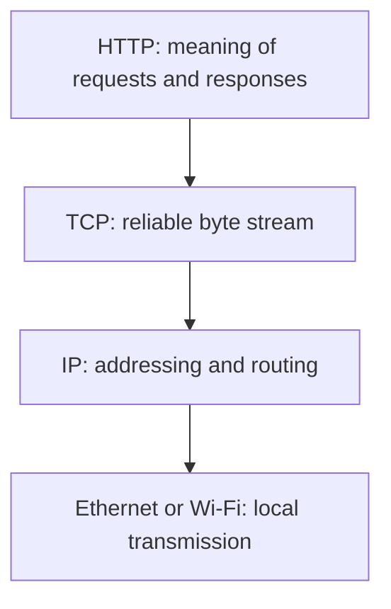

This illustrates HTTP/1.1 over TCP without TLS. HTTPS adds TLS; HTTP/3 uses QUIC over UDP instead.

HTTP is stateless at the protocol level: each request has its own meaning. Applications can maintain sessions using cookies, tokens and server-side state.

### Live demonstration

With the local server still running:

```bash
curl -i http://127.0.0.1:8080/
```

`-i` includes response headers. Use `curl.exe` on Windows if `curl` is an alias for another command.

**Next problem:** How do we tell the server whether we want to retrieve, submit or modify something?

---

## Phase 05 — HTTP requests and methods

An HTTP request communicates an intended operation on a resource. The following is an illustrative HTTP/1.1 request:

```http
GET /index.html HTTP/1.1
Host: 127.0.0.1:8080
Accept: text/html

```

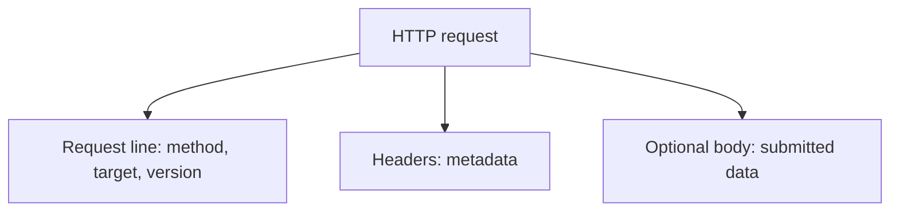

The blank line separates headers from any body. HTTP/2 and HTTP/3 use different wire framing but retain HTTP semantics.

| Method | Typical meaning | Example |
|---|---|---|
| GET | Retrieve a representation | GET /courses |
| POST | Submit data for processing | POST /registrations |
| PUT | Create or replace a resource at a known target | PUT /profiles/42 |
| PATCH | Apply a partial modification | PATCH /profiles/42 |
| DELETE | Request removal of a resource association | DELETE /profiles/42 |
| HEAD | Retrieve response metadata without response content | HEAD /index.html |

GET is intended to be safe (read-only semantics); PUT and DELETE are idempotent in their intended effect. POST is not necessarily idempotent. These are protocol semantics, not guarantees that every application implements them correctly.

### Example: submitting a registration

```http
POST /registrations HTTP/1.1
Host: example.com
Content-Type: application/json
Content-Length: 16

{"name":"Alice"}
```

The example body is 16 ASCII bytes. This is an illustrative endpoint, not a working registration API. Python's basic file server does not implement this application logic.

**Ask:** Which method would you use to retrieve a list of courses? Which would you use to submit a registration?

**Next problem:** How does the client know whether the operation succeeded?

---

## Phase 06 — HTTP responses and status codes

A response communicates the outcome of a request and may include a representation of a resource.

```http
HTTP/1.1 200 OK
Content-Type: text/html; charset=utf-8
Content-Length: 18

<h1>Hello Web</h1>
```

The example body is 18 ASCII bytes, excluding any trailing newline.

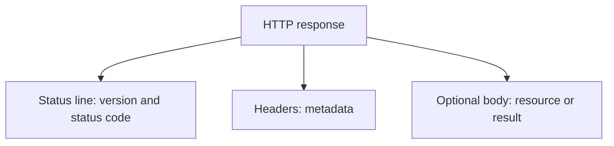

| Family | Meaning | Examples |
|---|---|---|
| 1xx | Informational | 100 Continue |
| 2xx | Successful | 200 OK, 201 Created, 204 No Content |
| 3xx | Redirection and related responses | 301 Moved Permanently, 302 Found, 304 Not Modified |
| 4xx | Client error | 400 Bad Request, 401 Unauthorized, 403 Forbidden, 404 Not Found |
| 5xx | Server error | 500 Internal Server Error, 503 Service Unavailable |

401 indicates missing or invalid authentication credentials; 403 means the server refuses the request. 404 means the resource was not found or the server is unwilling to disclose it.

### Live demonstration

```bash
curl -i http://127.0.0.1:8080/index.html
curl -i http://127.0.0.1:8080/missing.html
curl -I http://127.0.0.1:8080/index.html
```

Compare the status codes, headers and bodies. `-I` sends HEAD. Assuming the files match our setup, the first request succeeds and the second returns 404.

**Next problem:** What if someone can observe or modify traffic between client and server?

---

## Phase 07 — HTTPS and TLS

HTTPS is HTTP communicated over a secure transport using **Transport Layer Security (TLS)**. It provides confidentiality, integrity and server authentication when correctly configured and validated.

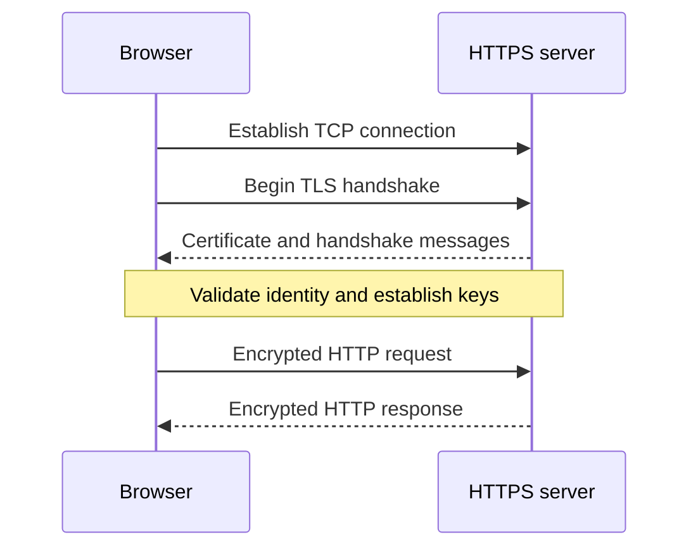

Simplified new HTTP/1.1 or HTTP/2 connection. HTTP/3 integrates TLS into QUIC.

| HTTP | HTTPS |
|---|---|
| No TLS protection | TLS-protected communication |
| Default port 80 | Default port 443 |
| Traffic can be observed or modified in transit | Protects HTTP content in transit |

HTTPS does not guarantee that a website is honest or that its application is free of vulnerabilities. It also does not hide all network metadata.

**Analogy:** A sealed, tamper-evident envelope sent to a verified recipient, rather than an open postcard.

**Demonstration:** Open `https://example.com` and inspect the browser's connection/security information. Do not enter personal information into demonstration sites.

**Next problem:** Which part of a web application actually produces the response?

---

## Phase 08 — Frontend, backend and databases

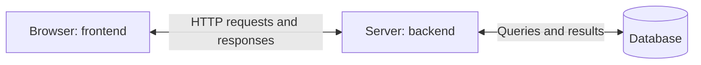

| Component | Responsibility | Examples |
|---|---|---|
| Frontend | User interface and browser-side behavior | HTML, CSS, JavaScript |
| Backend | Application logic, authorization, validation and resource delivery | Python, JavaScript, PHP, Java |
| Database | Persistent data storage and retrieval | PostgreSQL, SQLite, MySQL |

Not every website needs a database or a custom backend. Backend code normally executes on the server; browser-side JavaScript executes in the browser. JavaScript can also run on servers using an appropriate runtime.

### Example: club registration

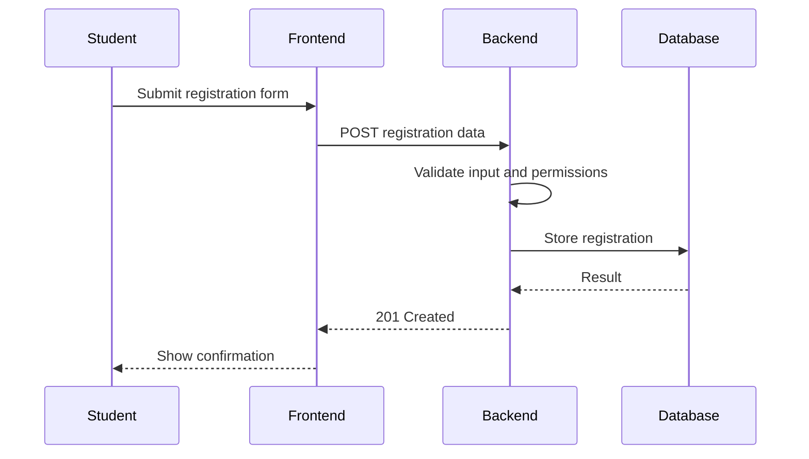

An **API** is an interface through which software interacts with other software. A web API often exchanges JSON over HTTP.

```json
{"id": 42, "name": "Alice", "registered": true}
```

This is fictional demonstration data. A real registration system must protect personal information and validate data on the server, not just in the browser.

**Next problem:** Does the server always generate a new page for each request?

---

## Phase 09 — Static and dynamic websites

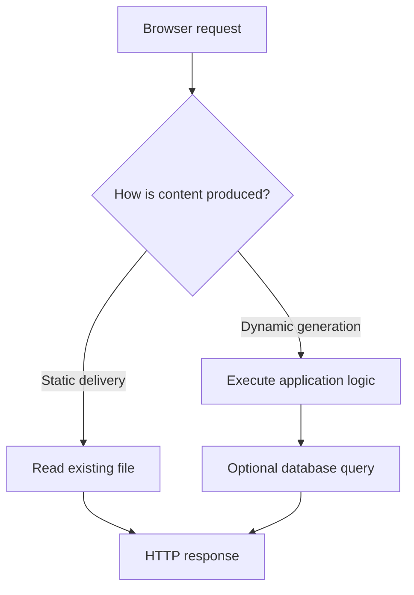

| Static delivery | Dynamic generation |
|---|---|
| Serves existing resources | Computes content based on request or state |
| Example: portfolio HTML file | Example: personalized dashboard |
| Can still include interactive JavaScript | Can return HTML or JSON |

Static does not mean visually inactive. A static page can use JavaScript, and a dynamic application can use cached or pre-generated content.

**Demonstration:** Edit `index.html` in the local workshop directory, save it and reload the browser. The file server delivers the updated file. Contrast this with a search application that computes results based on a query.

**Next problem:** The server has sent bytes. How does the browser turn those bytes into a visual page?

---

## Phase 10 — Browser rendering and the complete journey

The browser is not merely a network client: it parses documents, applies styles, executes scripts and renders an interface.

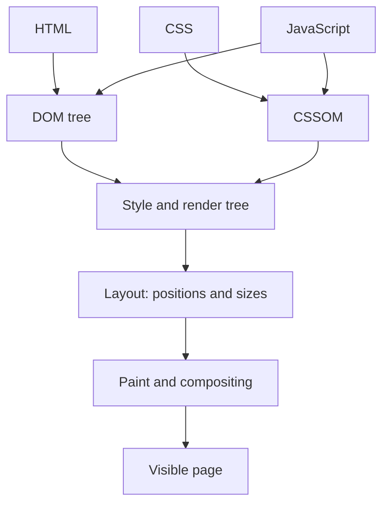

This is a simplified rendering model; browsers can fetch, parse and render incrementally, and JavaScript can affect the process at different points.

| Technology | Responsibility |
|---|---|
| HTML | Structure and semantic content |
| CSS | Presentation and layout |
| JavaScript | Behavior and interactivity |

### One small example

```html
<!doctype html>
<html lang="en">
<head>
  <meta charset="utf-8">
  <title>From Packets to Pixels</title>
  <style>
    body { font-family: sans-serif; background: #eef2ff; padding: 2rem; }
    button { background: #2563eb; color: white; padding: 0.75rem; }
  </style>
</head>
<body>
  <h1 id="message">Hello, Web!</h1>
  <button id="change">Click me</button>
  <script>
    document.querySelector('#change').addEventListener('click', () => {
      document.querySelector('#message').textContent = 'Welcome to the workshop!';
    });
  </script>
</body>
</html>
```

Save as `index.html` and reload the local page. Remove the style block to see HTML without custom CSS. Restore it, then remove the script to see the page without its custom click behavior.

### The complete journey: from URL to pixels

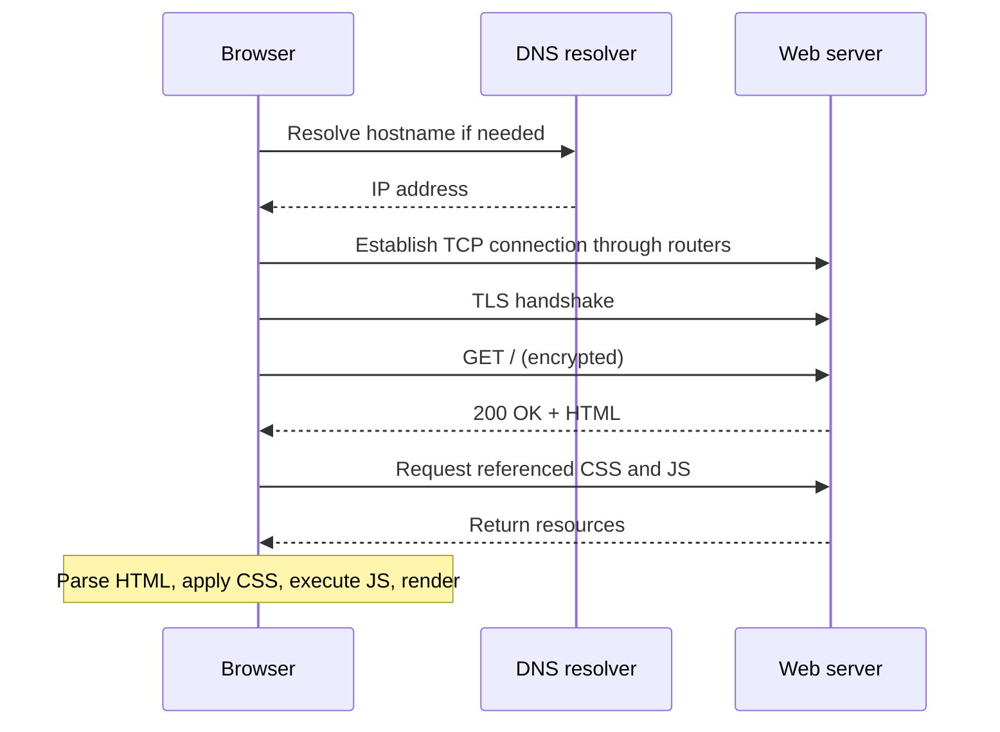

This assumes a fresh HTTPS connection using HTTP/1.1 or HTTP/2. Caching, connection reuse, HTTP/3 and resource loading order can change the actual sequence. Routing takes place throughout network communication, not just at one step.

### Browser Developer Tools exercise

1. Open the local workshop page.
2. Open Developer Tools (usually F12 or Ctrl+Shift+I; on macOS Cmd+Option+I where enabled).
3. Select **Network** and reload the page.
4. Select the document request and inspect its URL, method, status, headers and response.
5. Open **Elements** (or Inspector) and inspect the heading.
6. Click the button and observe how the DOM changes without requiring a new HTTP request.

---

## Knowledge check

| Question | Expected answer |
|---|---|
| Is the Web the same as the Internet? | No; it is a system of resources using the Internet. |
| What identifies a web resource? | A URL. |
| Which protocol defines web requests and responses? | HTTP. |
| What does 404 mean? | Resource not found or not disclosed. |
| What does HTTPS add? | Secure transport with TLS. |
| Where does frontend code usually run? | In the browser. |
| Can a static site be interactive? | Yes, through browser-side JavaScript. |
| Which technologies provide structure, appearance and behavior? | HTML, CSS and JavaScript, respectively. |

## Suggested presentation timing

| Topic | Minutes |
|---|---:|
| Web and client-server architecture | 4 |
| URLs and HTTP | 4 |
| Requests, methods and responses | 7 |
| HTTPS | 3 |
| Frontend, backend, static and dynamic | 4 |
| Rendering and complete journey | 4 |
| Live demonstration and knowledge check | 4 |
| **Total** | **30** |

For a 25-minute slot, shorten the method and status-code discussion and demonstrate only one local request. Detailed examples can remain in the README for later study.

## Further reading

- [CS50x 2021 — Web Development](https://cs50.harvard.edu/x/2021/notes/8/#web-development) — workshop inspiration.
- [MDN — HTTP](https://developer.mozilla.org/en-US/docs/Web/HTTP)
- [RFC 9110 — HTTP Semantics](https://www.rfc-editor.org/rfc/rfc9110)

This chapter follows our workshop roadmap, with additional examples and modern protocol context; it is not a reproduction of the CS50 notes.

---

## Next chapter — HTML

We now understand how a browser retrieves a web document. But how do we create the document itself, define its structure and connect it to other resources?

**Chapter 03: HTML — The structure of the Web.**
